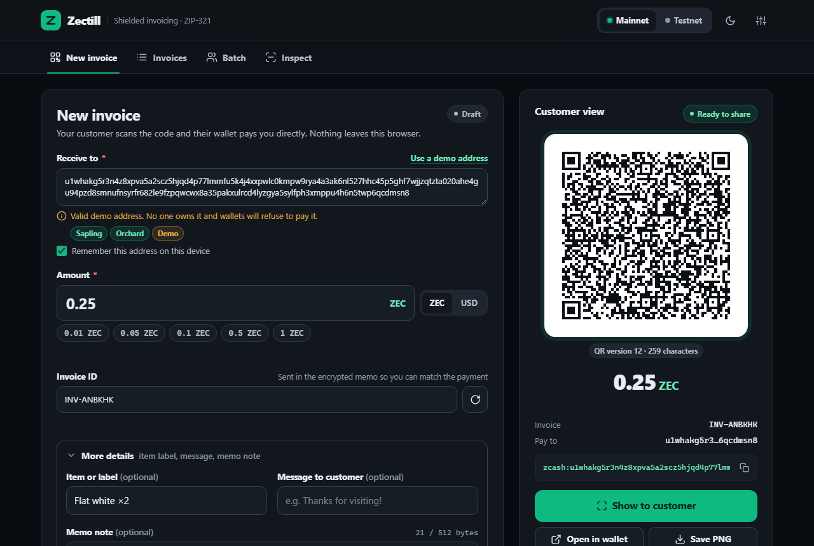
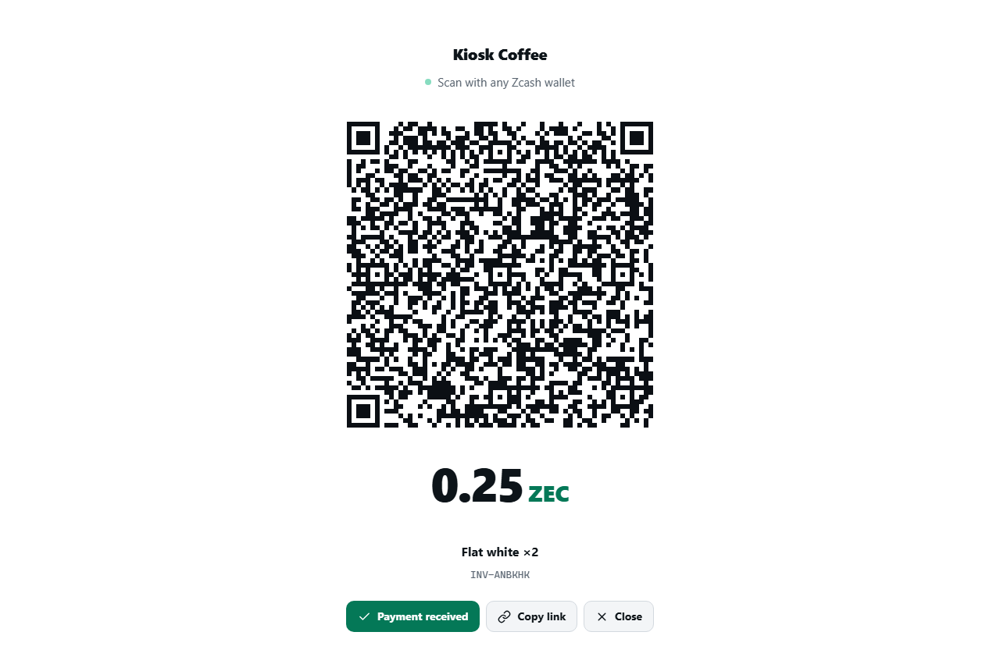
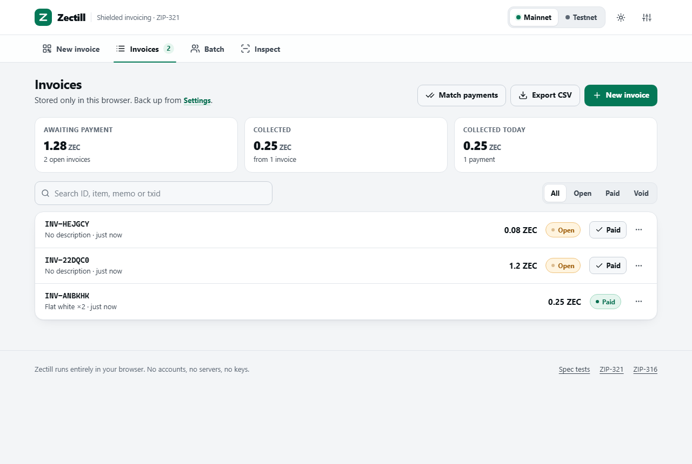
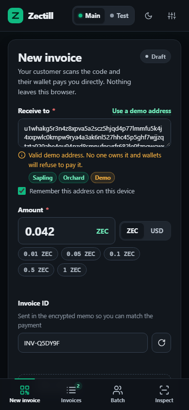
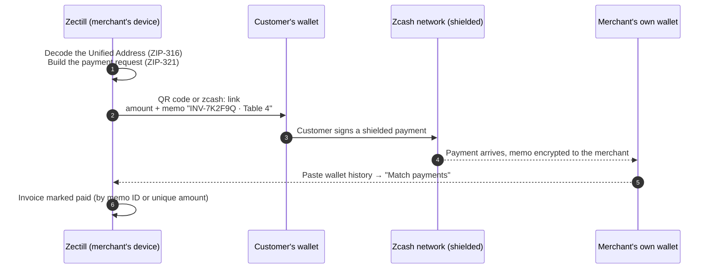
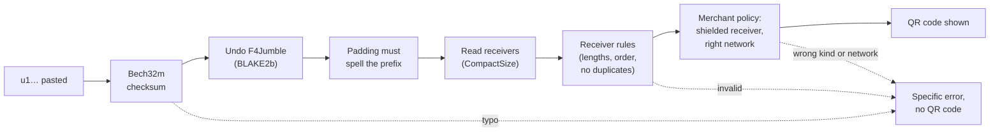

# Zectill

**A keyless till for shielded Zcash.** Any phone, tablet or laptop becomes a private point of sale: enter your own Unified Address and a price, and Zectill produces a spec-exact [ZIP-321](https://zips.z.cash/zip-0321) payment request (a QR code and `zcash:` link) and keeps an invoice book until you're paid. It also handles payouts, bill splits and settlements. No server, no account, no build step, and no keys.

[](https://zectill-sp.netlify.app)
[](https://zectill-sp.netlify.app/tests.html)

-555>)
[](LICENSE)

 **[Try it live](https://zectill-sp.netlify.app)** ·  **[Run the 215 spec checks in your browser](https://zectill-sp.netlify.app/tests.html)** ·  **[Demo video](TODO-ADD-VIDEO-LINK)**


 - **Team:** `Team Zectill`
 - **Hackathon:** `ZECATHON by zkSNARKs`



| Customer screen                                                             | Invoice book (light theme)                                                       | Phone                                                                 |
| --------------------------------------------------------------------------- | -------------------------------------------------------------------------------- | --------------------------------------------------------------------- |
|  |  |  |

---

## Proof at a glance

Every claim below can be checked in one click or one minute.

| Claim                                                                                                      | How to check it                                                                                                                                                                                                                                    |
| ---------------------------------------------------------------------------------------------------------- | -------------------------------------------------------------------------------------------------------------------------------------------------------------------------------------------------------------------------------------------------- |
| **Addresses are validated exactly as the official Zcash library validates them**, not just by their prefix | [Spec tests](https://zectill-sp.netlify.app/tests.html) → _Unified Addresses: official vectors_. All **60 official librustzcash vectors** are decoded, their receivers are compared byte for byte, and each is re-encoded to the identical string. |
| **Payment links are byte-for-byte what librustzcash produces**                                             | _ZIP-321 rendering_: the spec's own example `valid_1` is rebuilt character for character, and `valid_2` survives a parse and re-render unchanged.                                                                                                  |
| **Anything a wallet would reject is rejected here first**                                                  | _ZIP-321 parsing_: every invalid example in the spec, plus Sprout recipients. _Invalid encodings_: 15 malformed addresses (bad padding, truncation, duplicates, wrong order, typos).                                                               |
| **A typo never becomes a QR code**                                                                         | [Open the demo](https://zectill-sp.netlify.app), click _Use a demo address_, and change any character. You get a specific error and no QR code.                                                                                                    |
| **No server, no keys, no third-party code**                                                                | Open DevTools → Network and use the app. The only outside request is the optional CoinGecko price lookup, made when you price in fiat. The response headers include `Content-Security-Policy: default-src 'none'; script-src 'self'`.              |
| **The demo can't lose anyone's money**                                                                     | Demo addresses pass every encoding check, but their receiver keys are deliberately impossible values (an x-coordinate above the field modulus), so a real wallet refuses to pay them.                                                              |
| **Payments match even if a wallet drops the memo**                                                         | _Unique amounts_ tests: each invoice amount carries a per-ID tag of 1–999 zatoshis. Matching by amount is refused when two open invoices share an amount or the amount is round.                                                                   |
| **Batch requests are correct, not just plausible**                                                         | _Batch requests_ tests: every payout, bill-split and settlement request is parsed back the way a wallet would read it.                                                                                                                             |

**By the numbers:** 215 checks · 60 official address vectors · every ZIP-321 spec example · 0 servers · 0 build steps · 1 vendored library (QR drawing, MIT, SHA-384 pinned) · about 300 KB in total with no framework · 12 fiat currencies · needs no network after the page loads, except for fiat rates.

---

## How it works



Zectill never holds keys and never moves funds. The customer's wallet builds and signs the payment, and it lands directly in the merchant's own wallet. **The trust boundary is the QR code**, and Zectill's job is to make that code exactly right.

**What happens when you paste an address.** This is the same pipeline the official `zcash_address` crate runs:



---

## Hackathon plan vs what was delivered

| Planned                                                                   | Delivered                                                                                                                | Beyond the plan                                                                                                  |
| ------------------------------------------------------------------------- | ------------------------------------------------------------------------------------------------------------------------ | ---------------------------------------------------------------------------------------------------------------- |
| A merchant dashboard for single invoices and batch payouts |  Four views: create an invoice, track invoices, batch payments, and inspect any payment link or address | Works one-handed on a phone; usable by keyboard and screen reader; light and dark themes |
| ZIP-321 engine: Base64URL memos (512 bytes), single-invoice URI builder   |  Byte-identical to librustzcash, checked against the spec examples | Full parser, used by the Inspect tab; canonical amounts; exact `qchar` encoding                                  |
| Strict `u1` address validation                                            |  Complete ZIP-316 decode, not a prefix check | Identifies every Zcash address type and explains why each is refused; revision 2 (`zu`/`tu`) and expiry metadata |
| Live QR code, copy, "Open in wallet"                                      |  QR code redraws on every keystroke and disappears the moment any field is invalid; one-click copy of the payment link; "Open in wallet" launches the customer's Zcash wallet; drawn by a self-hosted, maintained library | QR size warnings, PNG payment cards, printable invoices and receipts                                             |
| "Mark as paid" toggle                                                     |  Payments are matched from pasted wallet history (memo ID or unique amount), or recorded by hand with a transaction ID | Optional merchant PIN with a shuffled keypad; press-and-hold when no PIN is set; part-payments with a balance request; undo |
| Batch payouts from `address, amount` lines                                |  One multi-recipient request, each line with its own memo | Bill split and settlement modes; CSV and spreadsheet paste; errors by line number                                |
| `localStorage` history                                                    |  A full invoice book: statuses, totals, search, filters | CSV export, JSON backup and restore, void, duplicate, delete with undo                                           |
| Responsive POS layout, error handling, deployable                         |  Phone, tablet and desktop layouts; every field explains its own problem in plain words; live on Netlify with a strict Content-Security-Policy | Full-screen customer screen that keeps the display awake; fiat pricing at a live rate locked for 5–60 minutes    |
| Test it                                                                   |  215 checks against official vectors, runnable in any browser and in CI | Wallet compatibility kit for testing real wallets on testnet                                                     |

---

## Who it's for

- **Market stalls and small shops** in cash-heavy or high-inflation economies. Price in local money (naira, rand, rupees and more), get paid in shielded ZEC, and use any old phone as the till. There is no card terminal or processor, and the device holds no funds to lose.
- **Teams paying contributors.** Pay a whole payroll or grant round in one shielded transaction, with a memo per person. Unlike on a transparent chain, salaries are not public.
- **Donation drives that must protect donors**, such as legal funds, mutual aid and independent journalism. A printed QR code works without a website, and memos tag each campaign.
- **Sensitive services** (pharmacies, clinics, legal aid, counselling), where the payment record itself is sensitive. The invoice book never leaves the device.
- **Pop-up markets and events.** Every vendor gets a keyless till on a borrowed tablet, payments go straight to each vendor's own wallet, and group tables split the bill with one code per person.

---

## Try it in two minutes

1. Open **https://zectill-sp.netlify.app**.
2. Click **Use a demo address**. The address is decoded on the spot, showing its Sapling and Orchard receivers.
3. Change one character of it. The checksum error appears and the QR code disappears. Undo the change.
4. Switch the price to **USD** and enter `4.50`. The live rate, the ZEC amount and the 15-minute price lock appear. The faded last digits are the invoice's unique matching tag (see *Unique amounts* below).
5. Click **Show to customer**. A tap on "Payment received" does nothing; **press and hold** it to confirm. With a merchant PIN set (Settings), it's a plain tap that asks for the PIN instead.
6. Open **Invoices → Match payments** and paste a line such as `2026-10-28, 0.25, INV-XXXXXX` using one of your invoice IDs.
7. Open **Batch → Bill split → Fill demo data**, then click a name to show that person's code.
8. Open **Inspect → Try the ZIP-321 spec example**.
9. Open **[Spec tests](https://zectill-sp.netlify.app/tests.html)** and watch 215 checks pass.

To run it locally, open `index.html` directly or serve the folder with `python -m http.server 8080`. Clipboard access needs HTTPS or `localhost`. For end-to-end tests with real funds, use your own **testnet** address; demo addresses are deliberately unpayable.

---

## Features

**Invoices**

- Live QR code and payment link as you type, priced in ZEC or in fiat at a live rate that is locked for 5–60 minutes, with a countdown. An expired quote blocks the QR code until you refresh it.
- A random invoice ID (`INV-7K2F9Q`) travels in the encrypted memo, with an optional note, item label and customer message. The memo meter counts bytes, not characters, against the 512-byte limit.
- **Unique amounts:** each invoice adds a tag of 1–999 zatoshis (under 0.00001 ZEC, about a cent at most) to its price. The tag is derived from the invoice ID, so the exact amount also identifies the invoice.
  - _Why:_ the memo is the main way a payment is matched, but some wallets and exchanges drop it, or the customer edits it. With the tag, a payment with no memo still points to exactly one open invoice.
  - _What you see:_ a 0.5 ZEC invoice asks for `0.50000245` ZEC. On the customer screen and the invoice preview, the price stays at full weight and the tag digits are faded after it (**0.5**<sub>0000245</sub>), so the price doesn't silently change. The wallet charges the full amount, and the merchant keeps the difference. A price that already uses the last three decimal places, such as `0.23726834`, gets no tag and is charged exactly as typed: it already identifies the invoice on its own. (Fiat prices are rounded to 0.00001 ZEC, so they always have room for the tag.)
  - _Safeguards:_ Zectill matches by amount only when the amount isn't round (tagged, or precise to the zatoshi) and belongs to exactly one open invoice. Every match says whether it came from the memo or the amount.
  - _Turning it off:_ switch off **Settings → Unique amounts** to charge exact prices. Memo matching still works; only the fallback for payments without a memo is lost.
- Saving locks the invoice so it always matches the QR code the customer has. Sharing, printing or showing the code saves it automatically.
- **Customer screen:** full screen, always light for reliable scanning, with a large QR code, the fiat price and the quote countdown. It keeps the display awake where the browser supports it. Without a PIN, "Payment received" is press-and-hold, so a stray tap does nothing. It records the full amount; for anything else, use **Received a different amount?** below it.
- **Merchant PIN (optional):** once set, "Payment received" becomes a plain tap, and confirming a payment or leaving the customer screen needs the PIN, so a customer can't mark their own invoice paid. Digits show as dots, and the keypad is reshuffled every time so watching fingers reveals nothing. Five wrong tries pause the keypad (30 s, then doubling), and a page reload reopens the locked screen. Only a salted hash of the PIN is stored.
- Save a PNG payment card, print an invoice with its QR code, or print a receipt once paid.

**Getting paid**

- **Match payments:** paste your wallet's history (a CSV export, copied memos, or `z_listreceivedbyaddress`-style JSON, whose hex memos are decoded). Zectill matches by the invoice ID in the memo, or by unique amount when the memo is missing, and proposes paid, part-paid or check for each invoice.
- **Record payment** (under the invoice preview, or on any row in the invoice book) takes the amount received and an optional transaction ID (validated as 64 hex characters). Underpayments become part-paid. On the customer screen, **Received a different amount?** opens the same dialog without leaving the screen (behind the PIN, if one is set), and a short payment immediately turns the QR code into a balance request. Recording a payment, voiding and deleting can all be undone.
- **Collect the balance:** a part-paid invoice stays open and asks only for what is still owed. **Request balance** shows a new QR code for just the balance, with the same address and invoice ID in the memo, and copied links, PNG cards and printed invoices switch to the balance too. Payments add up, and the invoice turns paid once the total covers it. Matching is checked against the balance, and pasting the same wallet history again never counts a recorded transaction twice. A balance stays fixed in ZEC; it isn't re-priced at a new fiat rate.
- Invoice book: outstanding, collected and collected-today totals, search, status filters, void, duplicate, and CSV export (formula-injection safe, UTF-8 with BOM for Excel).

**Batch payments**

| Mode                         | Who signs   | Output                                                                                                |
| ---------------------------- | ----------- | ----------------------------------------------------------------------------------------------------- |
| **Payout** (1 → many)        | One payer   | One multi-recipient ZIP-321 request; each line keeps its own memo                                     |
| **Bill split** (many → 1)    | Each person | One request per person to your address; the memo is "reference · name", so your wallet shows who paid |
| **Settlement** (many → many) | Each payer  | One request per debt; the memo tells the recipient who paid                                           |

A ZIP-321 request asks **one** wallet to build **one** transaction, so multi-payer cases become one request per payer. Lists can be pasted from a spreadsheet (tab, comma or semicolon separated, quotes allowed) or imported as a CSV file. Errors are reported by line number with click-to-jump, valid lines still work, and duplicate recipients raise a warning. Batches can be saved and reloaded, and bill splits print as a sheet of QR cards.

**Inspect:** paste any `zcash:` link or Zcash address to see whether a spec-compliant wallet would accept it, and why not if it wouldn't. The view shows every payment, address type, network, revision, receivers with their sizes, expiry, and the decoded memo, label and message.

**Everything else:** mainnet (ZEC) and testnet (TAZ) with a persistent testnet banner and one-click recovery when an address belongs to the other network; dark, light and automatic themes; keyboard navigation, focus rings, live regions and reduced-motion support; JSON backup and restore.

---

## Under the hood

<details>
<summary><b>Address validation (ZIP-316)</b></summary>

Zectill decodes Unified Addresses completely in plain JavaScript, with no WASM and no library:

1. **Bech32m**, with no 90-character limit (ZIP-316 requires this). All-uppercase input is normalised; mixed case is rejected.
2. **F4Jumble⁻¹**, using BLAKE2b with the `UA_F4Jumble_H` / `UA_F4Jumble_G` personalisations.
3. The **16-byte padding**, which must equal the address prefix.
4. **CompactSize** typecode and length items, canonical encodings only.
5. **Receiver rules**, matching `zcash_address`:
   - exact receiver lengths;
   - strictly ascending typecodes, with no duplicates;
   - never both P2PKH and P2SH;
   - at least one non-transparent item in revision 0;
   - no transparent receiver in a revision 2 `zu` address;
   - metadata must-understand rules, and expiry metadata (an expired address is refused).

Sapling, transparent (P2PKH/P2SH), TEX and Sprout addresses are identified too (Bech32, and Base58Check with SHA-256), so a merchant who pastes the wrong kind gets a specific explanation.

**Merchant policy** on top of the spec: Zectill only invoices to Unified Addresses on the selected network that have a Sapling or Orchard receiver.

**Not checked:** whether receiver bytes are valid curve points. `zcash_address` doesn't check this when parsing either; the paying wallet does.

**Revision 2** (`zu…`, `tu…`) follows the same librustzcash rules, but only constructed test cases cover it, because librustzcash publishes no official revision 2 vectors yet.

</details>

<details>
<summary><b>Payment requests (ZIP-321)</b></summary>

- **Rendering matches librustzcash `TransactionRequest::to_uri` byte for byte:**
  - canonical amounts (`0.10` → `0.1`);
  - parameter order amount, memo, label, message;
  - the exact `qchar` percent-encoding set;
  - the empty index for payment 0 (never `.0`).
- **The parser follows `TransactionRequest::from_uri`:**
  - indices 1–9999 with no leading zeros;
  - duplicate parameters and unknown `req-` parameters rejected;
  - memos only to memo-capable addresses;
  - no zero-value transparent outputs and no Sprout recipients;
  - strict unpadded Base64URL memos of at most 512 bytes.
- **Amounts** are integer zatoshis (`BigInt`) throughout, so totals never drift (`0.1 + 0.2 = 0.3`).
</details>

<details>
<summary><b>Payment tracking, and the plan for automatic detection</b></summary>

Shielded payments can only be seen with a viewing key. Zectill doesn't ask for one, so it never pretends to detect payments. Instead:

1. **The invoice ID travels in the encrypted memo**, so every payment arrives tagged in the merchant's own wallet.
2. **Match payments** reads whatever the wallet can export:
   - It finds invoice IDs as whole tokens and prefers an amount equal to the amount due.
   - It de-duplicates by transaction ID and proposes paid, part-paid or check for each invoice.
   - If the memo is missing, it matches by unique amount, but only when the amount isn't round (it carries an invoice tag, or the price was already precise to the zatoshi) and belongs to exactly one open invoice. Each result says whether it came from the memo or the amount.
3. **Manual confirmation**, with the amount received and a transaction ID, for counter sales.

**Planned automatic detection:** the merchant pastes an incoming viewing key, held in memory only and never stored. The page fetches compact blocks from lightwalletd through a gRPC-web proxy and trial-decrypts outputs in a WASM build of the Zcash light-client code. Unique amounts already make matching work from amounts alone, which is what compact blocks provide. Memos need a separate full-transaction fetch.

</details>

<details>
<summary><b>Privacy and security</b></summary>

- **No server.** Invoices, batches and settings live in this browser's `localStorage`, with a JSON backup in Settings.
- **One optional outside request:** CoinGecko's public price API, only when you price in fiat. It carries no invoice data and is sent without credentials or a referrer.
- **No third-party code at runtime.** The QR library is vendored and pinned by SHA-384 (`vendor/README.md`), and fonts are system fonts.
- **Strict headers** (`_headers` for Netlify, `vercel.json` for Vercel):
  - `default-src 'none'; script-src 'self'; style-src 'self'; connect-src https://api.coingecko.com; frame-ancestors 'none'`;
  - `nosniff`, `no-referrer`, HSTS and a restrictive Permissions-Policy.

  The app has no inline scripts or styles, which is what makes this policy possible.

- **What a QR code reveals:** the address, amount, memo, label and message are plain text in the URI, readable by anyone who sees the code. On-chain, the payment is shielded and the memo is encrypted. Keep private details out of labels and messages.
</details>

---

## Testing

Open **[tests.html](https://zectill-sp.netlify.app/tests.html)**. It runs the shipped engine, with nothing mocked, against official vectors: **215 checks**, all passing.

| Group                                                                                                                 | Source                                                      |
| --------------------------------------------------------------------------------------------------------------------- | ----------------------------------------------------------- |
| BLAKE2b, SHA-256                                                                                                      | RFC 7693, FIPS 180-4                                        |
| Bech32 / Bech32m                                                                                                      | BIP 173, BIP 350                                            |
| F4Jumble round trips                                                                                                  | ZIP 316 length rules                                        |
| **60 official Unified Address vectors**: decoded, receivers compared byte for byte, re-encoded identically            | librustzcash `unified/address/test_vectors.rs`              |
| Invalid UA encodings (padding, truncation, duplicates, ordering, P2PKH+P2SH, revision 2 rules, metadata, typos, case) | librustzcash `unified/address.rs` tests + constructed cases |
| Address kinds (Sprout, Sapling, transparent, TEX, Unified on every network)                                           | librustzcash `encoding.rs`                                  |
| Amounts, memos                                                                                                        | librustzcash `zip321`                                       |
| ZIP-321 rendering (byte-exact) and parsing (every valid and invalid spec example, Sprout rejection)                   | librustzcash `zip321` tests                                 |
| Merchant policy, batch parser, payment matching                                                                       | Zectill                                                     |
| Batch requests: every request parsed back as a wallet would                                                           | Zectill                                                     |
| Unique amounts: tag range and stability, matching by amount, ambiguity safeguards                                     | Zectill                                                     |

Headless (the page title becomes `PASS n/n` or `FAIL k/n`):

```sh
chrome --headless=new --disable-gpu --virtual-time-budget=15000 --dump-dom "file:///path/to/tests.html" | grep -o "<title>[^<]*"
```

`.github/workflows/spec-tests.yml` runs the same check on every push.

---

## Project structure

```
index.html              App shell: four views, dialogs, customer screen
tests.html              Spec test suite + wallet compatibility kit
assets/zcash.js         Engine, pure and dependency-free: BLAKE2b, SHA-256, Bech32m,
                        Base58Check, F4Jumble, Unified Address codec, ZIP-321 render/parse,
                        merchant policy, batch requests, unique amounts, payment matching
assets/app.js           UI: invoice editor, quotes, customer screen, invoice book,
                        matching, batch, inspector, settings, backup
assets/zectill.css      Design system: theme tokens, components, print styles
assets/theme.js         Applies the saved theme before first paint
assets/tests.js         Test suite; assets/test-vectors.js holds the 60 official UA vectors
vendor/                 qrcode-generator 2.0.4 (MIT), self-hosted, SHA-384 pinned
docs/                   Screenshots
_headers, vercel.json   Security headers for Netlify and Vercel
.github/workflows/      CI: runs the spec suite in headless Chrome
```

The engine is exposed as `window.ZcashKit` in the browser console:

```js
ZcashKit.ua.decode("u1…"); // receivers, revision, expiry
ZcashKit.zip321.parse("zcash:u1…?amount=1"); // exactly what a wallet would see
```

**Deploy:** it's a static site. Upload the folder to Netlify (which reads `_headers`), Vercel (which reads `vercel.json`) or any static host. There is no build step.

---

## Known limitations and what's next

| Today | Why | Next |
|---|---|---|
| **The merchant confirms payments**, by matching their wallet history or confirming at the counter | Shielded payments are private by design: only a viewing key can see them, and Zectill deliberately holds no keys | Automatic detection with an incoming viewing key held only in memory (design under *Payment tracking* above). Unique amounts already let matching work from amounts alone, which is what a light client sees first |
| **The merchant PIN locks Zectill, not the device** | A web page can't stop someone leaving the browser | Use the device's own lock as well (Guided Access on iPhone and iPad, screen pinning on Android); a packaged kiosk app could enforce it directly |
| **Fiat prices come from one public rate API** | It keeps the app free of servers and accounts | Rate cross-checks against a second source. ZEC pricing works whenever the rate API is unavailable |
| **Multi-recipient support varies by wallet** | ZIP-321 multi-payment requests are newer than single payments | Publish real-wallet results gathered with the built-in compatibility kit |

Also planned: shareable invoice links for remote payment, and an installable offline version for counters with poor connectivity.

## Credits and license

- Icons: drawn after [Lucide](https://lucide.dev) (ISC licence), in the app and in this README.
- QR encoding: [qrcode-generator](https://github.com/kazuhikoarase/qrcode-generator) by Kazuhiko Arase, MIT.
- Test vectors and reference rules: [zcash/librustzcash](https://github.com/zcash/librustzcash), MIT / Apache-2.0.
- Specs: [ZIP-321](https://zips.z.cash/zip-0321), [ZIP-316](https://zips.z.cash/zip-0316), [ZIP-302](https://zips.z.cash/zip-0302), [BIP-350](https://github.com/bitcoin/bips/blob/master/bip-0350.mediawiki).

Zectill is released under the [MIT License](LICENSE).
